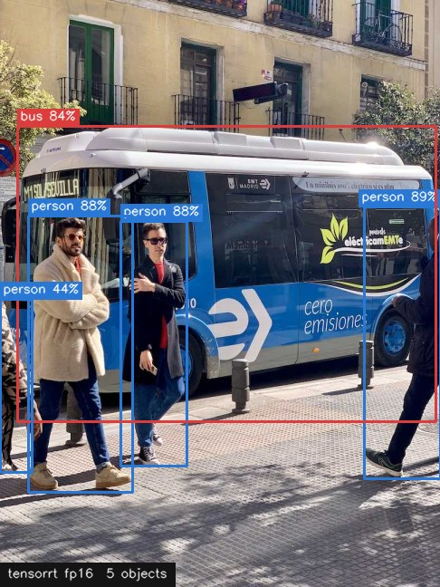

# EdgeVision

[](https://github.com/eliftb/EdgeVision/actions/workflows/tests.yml)

[Türkçe](README.tr.md)

A real-time object detection pipeline (camera or video in, annotated video out) and a benchmark that runs the same YOLOv8n model on PyTorch, ONNX Runtime and TensorRT to show what each runtime buys you.



*Detections from the TensorRT fp16 engine on Ultralytics' `bus.jpg` sample image.*

## Results

One 810×1080 frame, end to end (letterbox, network, NMS, boxes copied to the CPU). RTX 4060 Laptop GPU, 300 timed runs after 30 warm-up runs, batch size 1:

| Backend | File size | Frame mean | p95 | FPS | Speed-up | Network only | mAP50-95 |
|---|---|---|---|---|---|---|---|
| PyTorch fp32 | 6.2 MB | 7.8 ms | 9.0 ms | 128 | 1.00x | 4.3 ms | 0.454 |
| PyTorch fp16 | 6.2 MB | 8.9 ms | 10.5 ms | 113 | 0.88x | 5.4 ms | 0.453 |
| ONNX Runtime (CUDA) | 12.3 MB | 8.3 ms | 9.0 ms | 120 | 0.94x | 4.3 ms | 0.454 |
| TensorRT fp32 | 19.1 MB | 5.7 ms | 6.5 ms | 176 | 1.37x | 1.9 ms | 0.453 |
| TensorRT fp16 | 8.6 MB | 4.9 ms | 5.7 ms | 203 | 1.58x | 1.2 ms | 0.453 |

What the numbers say:

- **TensorRT fp16 makes the network 3.6x faster (4.3 ms to 1.2 ms), but the whole frame only 1.6x faster.** About 3.5 ms per frame is preprocessing and NMS, which no engine touches. Once the network is this fast, that fixed part is three quarters of the frame time and is the next thing to optimise.
- **Accuracy does not move.** mAP50-95 stays within 0.001 across all five, so fp16 costs nothing measurable here.
- **fp16 does not help PyTorch.** On a model this small, half precision in PyTorch was slower than fp32 in every run. The gain only shows up once TensorRT fuses layers and picks fp16 kernels.
- **ONNX Runtime with the CUDA provider matches PyTorch.** It is a portability step, not a speed-up, on this GPU.

The full pipeline (decode a 1280×720 video, detect, draw) ran at 103 fps with PyTorch, 99 fps with ONNX Runtime and 149 fps with the TensorRT fp16 engine.

How to read these numbers honestly:

- They were measured on a laptop GPU, not on a Jetson or another embedded board. The ranking of the runtimes carries over; the absolute numbers do not.
- mAP is computed on COCO128, 128 images that YOLOv8n was trained on. It is here to check that an export has not lost accuracy, not to rate the model.
- Timings move by a few tenths of a millisecond between runs.
- Versions: PyTorch 2.0.1 (CUDA 11.7), Ultralytics 8.3.170, ONNX Runtime 1.18.1, TensorRT 10.13.

## Quick start

```bash
pip install -r requirements.txt

python main.py                                   # camera 0, PyTorch weights
python main.py --source video.mp4                # a video file
python main.py --source video.mp4 --record outputs/result.mp4
python main.py --no-display --max-frames 300     # no window, e.g. over SSH
```

Press `q` or `Esc` to quit. `yolov8n.pt` is downloaded on the first run.

## Export and benchmark

ONNX and TensorRT need extra packages; the ones used for the table above are listed at the bottom of `requirements.txt`.

```bash
python -m edgevision.export yolov8n.pt onnx
python -m edgevision.export yolov8n.pt engine --half     # TensorRT fp16; takes a few minutes

python main.py --weights yolov8n-fp16.engine             # same pipeline, faster runtime

python -m edgevision.benchmark --accuracy                # reproduces the table
```

A TensorRT engine only works on the GPU model and TensorRT version it was built with, so build it on the device that will run it.

## How it is organised

```
main.py                  capture -> detect -> draw -> show / record
edgevision/
  source.py              camera or video file behind one interface
  detector.py            YOLO on .pt / .onnx / .engine, returns Detection objects
  draw.py                boxes, labels, status line
  fps.py                 frame-rate meter
  recorder.py            MP4 writer
  export.py              ONNX and TensorRT export
  benchmark.py           latency, size and mAP per backend
tests/                   16 tests, no weights, GPU or camera needed
```

Two details that are easy to get wrong:

- **FPS is counted from the first frame**, not from program start. Counting from start folds model loading into the average and reports a rate far below what the pipeline sustains.
- **The recorder takes its frame size from the first frame.** OpenCV silently drops frames that do not match the size the writer was opened with, which produces an empty video.

## Tests

```bash
python -m pytest -q tests
```

GitHub Actions runs them on every push and pull request (Python 3.10 and 3.12).

## Background

Written while preparing for Baykar's "running end-to-end vision models on an edge device" exam. The detector is [Ultralytics YOLOv8](https://github.com/ultralytics/ultralytics) (AGPL-3.0).
