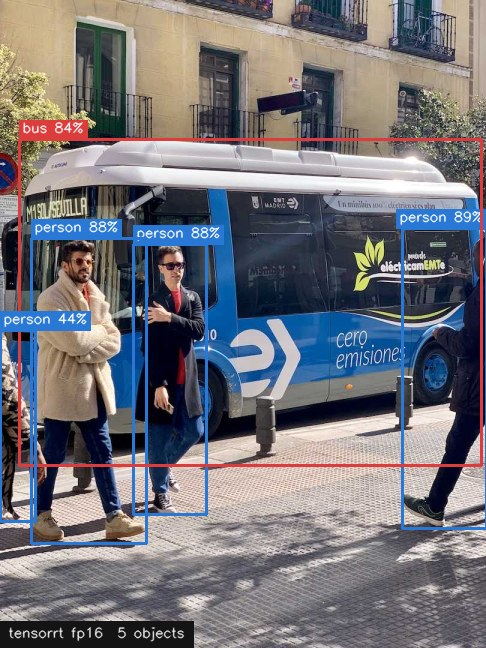

# EdgeVision

[](https://github.com/eliftb/EdgeVision/actions/workflows/tests.yml)

[English](README.md)

Gerçek zamanlı nesne tespiti hattı (kamera ya da video girer, kutuları çizilmiş video çıkar) ve aynı YOLOv8n modelini PyTorch, ONNX Runtime ve TensorRT üzerinde çalıştırıp her birinin ne kazandırdığını ölçen bir karşılaştırma aracı.



*Ultralytics'in `bus.jpg` örnek görselinde TensorRT fp16 motorunun tespitleri.*

## Sonuçlar

810×1080 tek kare, uçtan uca (letterbox, ağ, NMS, kutuların CPU'ya kopyalanması). RTX 4060 Laptop GPU, 30 ısınma çalıştırmasından sonra 300 ölçüm, batch boyutu 1:

| Çalışma biçimi | Dosya boyutu | Kare ortalaması | p95 | FPS | Hızlanma | Yalnızca ağ | mAP50-95 |
|---|---|---|---|---|---|---|---|
| PyTorch fp32 | 6,2 MB | 7,8 ms | 9,0 ms | 128 | 1,00x | 4,3 ms | 0,454 |
| PyTorch fp16 | 6,2 MB | 8,9 ms | 10,5 ms | 113 | 0,88x | 5,4 ms | 0,453 |
| ONNX Runtime (CUDA) | 12,3 MB | 8,3 ms | 9,0 ms | 120 | 0,94x | 4,3 ms | 0,454 |
| TensorRT fp32 | 19,1 MB | 5,7 ms | 6,5 ms | 176 | 1,37x | 1,9 ms | 0,453 |
| TensorRT fp16 | 8,6 MB | 4,9 ms | 5,7 ms | 203 | 1,58x | 1,2 ms | 0,453 |

Rakamların söylediği:

- **TensorRT fp16 ağı 3,6 kat hızlandırıyor (4,3 ms'den 1,2 ms'ye), ama karenin tamamını yalnızca 1,6 kat.** Kare başına yaklaşık 3,5 ms ön işleme ve NMS'e gidiyor; buna hiçbir motor dokunmuyor. Ağ bu kadar hızlanınca o sabit kısım kare süresinin dörtte üçü oluyor ve bir sonraki iyileştirilecek yer orası.
- **Doğruluk değişmiyor.** mAP50-95 beş seçenekte de 0,001 içinde kalıyor; fp16'nın burada ölçülebilir bir bedeli yok.
- **fp16 PyTorch'ta işe yaramıyor.** Bu kadar küçük bir modelde PyTorch'ta yarı duyarlık her çalıştırmada fp32'den yavaş çıktı. Kazanç ancak TensorRT katmanları birleştirip fp16 çekirdeklerini seçince geliyor.
- **CUDA sağlayıcılı ONNX Runtime PyTorch ile aynı hızda.** Bu ekran kartında hızlanma değil, taşınabilirlik adımı.

Hattın tamamı (1280×720 videoyu çöz, tespit et, çiz) PyTorch ile 103 fps, ONNX Runtime ile 99 fps, TensorRT fp16 motoruyla 149 fps çalıştı.

Bu rakamlar okunurken:

- Ölçümler bir laptop ekran kartında yapıldı; Jetson ya da başka bir gömülü kartta değil. Çalışma biçimlerinin sıralaması taşınır, mutlak rakamlar taşınmaz.
- mAP, YOLOv8n'in eğitiminde de yer alan 128 görsellik COCO128 üzerinde hesaplandı. Amacı dışa aktarmanın doğruluk kaybettirmediğini doğrulamak, modeli puanlamak değil.
- Süreler çalıştırmadan çalıştırmaya milisaniyenin onda birkaçı kadar oynuyor.
- Sürümler: PyTorch 2.0.1 (CUDA 11.7), Ultralytics 8.3.170, ONNX Runtime 1.18.1, TensorRT 10.13.

## Çalıştırma

```bash
pip install -r requirements.txt

python main.py                                   # 0 numaralı kamera, PyTorch ağırlıkları
python main.py --source video.mp4                # video dosyası
python main.py --source video.mp4 --record outputs/sonuc.mp4
python main.py --no-display --max-frames 300     # penceresiz, örneğin SSH üzerinden
```

Çıkmak için `q` ya da `Esc`. `yolov8n.pt` ilk çalıştırmada indirilir.

## Dışa aktarma ve karşılaştırma

ONNX ve TensorRT için ek paketler gerekir; tablodaki ölçümde kullanılanlar `requirements.txt` dosyasının sonunda yazılıdır.

```bash
python -m edgevision.export yolov8n.pt onnx
python -m edgevision.export yolov8n.pt engine --half     # TensorRT fp16; birkaç dakika sürer

python main.py --weights yolov8n-fp16.engine             # aynı hat, daha hızlı çalışma biçimi

python -m edgevision.benchmark --accuracy                # tabloyu yeniden üretir
```

TensorRT motoru yalnızca üretildiği ekran kartı modelinde ve TensorRT sürümünde çalışır; bu yüzden motoru çalışacağı cihazda üretin.

## Testler

```bash
python -m pytest -q tests
```

16 test var; model ağırlığı, ekran kartı ya da kamera gerektirmez. GitHub Actions bunları her push ve pull request'te çalıştırır (Python 3.10 ve 3.12).

## Arka plan

Baykar'ın "Edge Device Üzerinde Uçtan Uca Görü Modellerinin Çalıştırılması" sınavına hazırlanırken yazıldı. Tespit modeli [Ultralytics YOLOv8](https://github.com/ultralytics/ultralytics) (AGPL-3.0).
